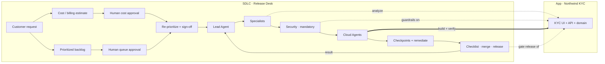

# Release Desk — Architecture (Mermaid)

Last updated: 2026-11-17 (Asia/Calcutta)

Two lanes: **SDLC** builds and verifies **KYC**. Queue item approval and cost-record approval are both required before Lead. **Security is mandatory on every change.**

