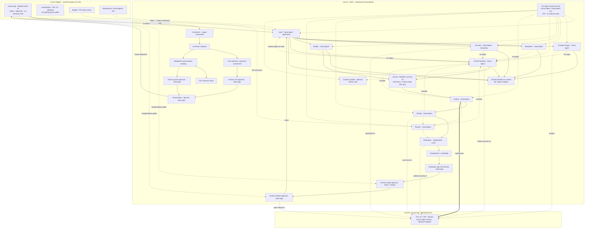

# Release Desk — Architecture (Mermaid)

Last updated: 2026-11-17 (Asia/Calcutta)

**Cursor-maximized + implemented runtime:** ephemeral **Cloud Agents** run Lead, specialists, Coding / Testing / Review, and AI Red Teaming (MOCK by default); **Cursor Apps** host Desk + KYC. Desk triggers Lead **on-demand** after human dual approval — **no** backlog queue poller. Shared durable run context crosses ephemeral VMs. Distinct **Testing** vs **Verification** before checkpoints. Capability map: [`cursor-maximized-architecture.md`](./cursor-maximized-architecture.md).

## How to read this

| Box | Cursor capability |
| --- | --- |
| Desk UI / KYC | **Cursor Apps** (publish-app hosting) — always-on served layer |
| Lead, CA, Standards, Security, Builder, AI Red Teaming, Coding, Testing, Review | **Cloud Agents** / Cloud Agents API (ephemeral; MOCK default) |
| Automations | PR/CI/webhook → Desk→Lead **on-demand** (not a backlog poller) |
| Bugbot | Complementary PR review on GitHub |
| Shared store | Durable run context for ephemeral agents (`FileBackedRunContextStore` / Apps Postgres) |
| NHI named secrets | Distinct `RELEASEDESK_CURSOR_API_KEY_*` in **Cursor Apps / Cloud Agent environment secrets** (Runtime Secrets preferred); no external vault; prefer OIDC when available |
| Zscaler | Optional **provider stub** behind `RELEASEDESK_AI_RED_TEAM_PROVIDER=zscaler` (MOCK without credentials) |

See [`nhi-cursor-secrets.md`](./nhi-cursor-secrets.md) and [`.env.example`](../.env.example) for secret **names** only. Dashed `Zscal` = optional stub. See [`zscaler-ai-red-teaming-provider.md`](./zscaler-ai-red-teaming-provider.md).
