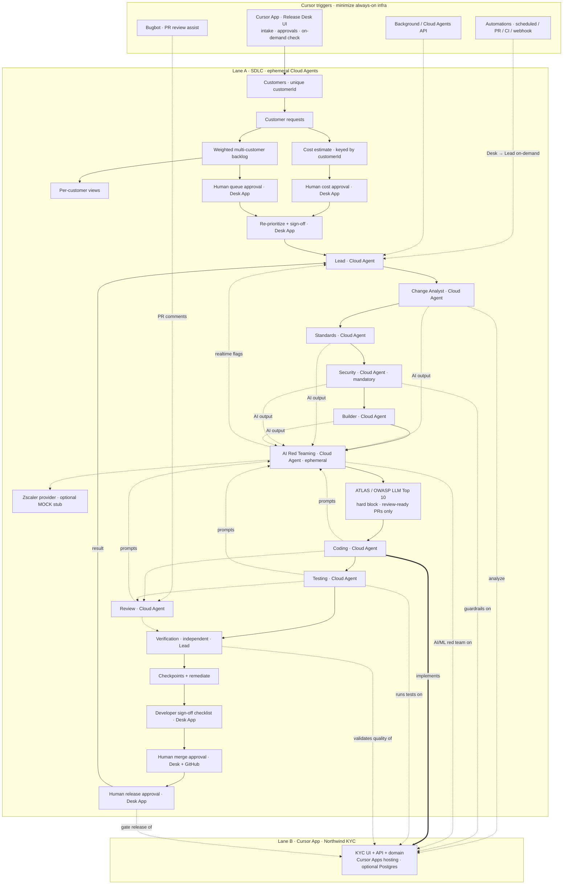

# Release Desk — Architecture (Mermaid)

Last updated: 2026-11-17 (Asia/Calcutta)

**Cursor-maximized target:** ephemeral **Cloud Agents** run Lead, specialists, Coding / Testing / Review, and AI Red Teaming; **Cursor Apps** host Desk + KYC. Distinct **Testing** vs **Verification** before checkpoints. Summary: [`cursor-maximized-architecture.md`](./cursor-maximized-architecture.md).

## How to read this

| Box | Cursor capability |
| --- | --- |
| Desk UI / KYC | **Cursor Apps** (publish-app hosting) |
| Lead, CA, Standards, Security, Builder, AI Red Teaming, Coding, Testing, Review | **Cloud Agents** / Cloud Agents API (ephemeral) |
| Automations | Event/schedule triggers for Desk→Lead and PR/CI follow-ups |
| Bugbot | Complementary PR review on GitHub |
| Background agents | Same Cloud Agents product surface (API / dashboard / mobile) |
| Zscaler | Optional **provider stub** behind `RELEASEDESK_AI_RED_TEAM_PROVIDER=zscaler` (MOCK without credentials); live Zscaler stays an **external** API if ever wired |

Dashed `Zscal` = optional stub. See [`zscaler-ai-red-teaming-provider.md`](./zscaler-ai-red-teaming-provider.md).
