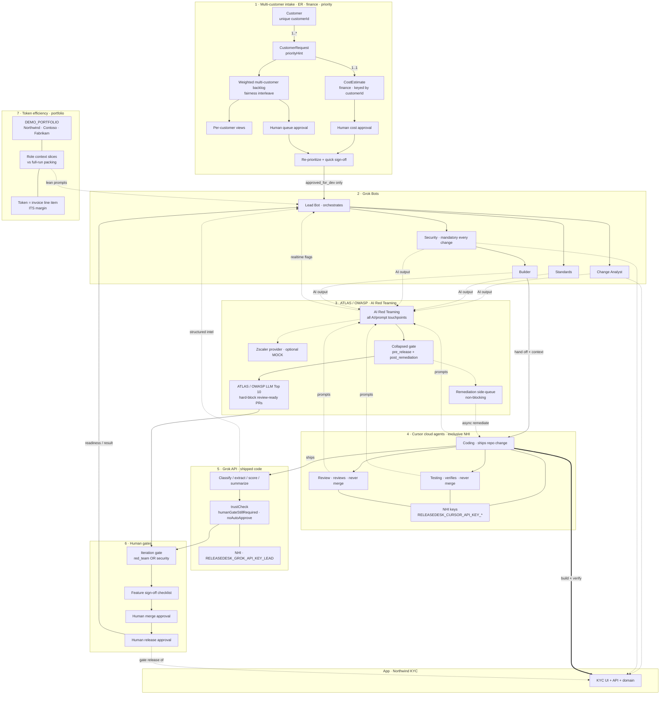

# Release Desk — Architecture (Mermaid)

Last updated: 2026-11-17 (Asia/Calcutta)

**Full SDLC control plane** — do not drop stages for slide brevity. Multi-customer ER + finance + priority fairness feed Lead; Grok Bots + Cursor Coding/Testing/Review; ATLAS/OWASP; Grok API intel; token efficiency; NHI exclusive keys; human gates; readiness closes the circle back to Lead.

Child slices under each of the five bots are documented in [`sub-agents.md`](./sub-agents.md). They are not extra roster bots.

**Slide 2** uses a 4-wire room map in [`spacexai-demo-slides.md`](./spacexai-demo-slides.md). **This file keeps the full workflow.** Live surface: `/control`.

## Narrative (match `/control` stages)

1. **Intake** — Customer ER, CostEstimate finance, dual human approvals, fairness priority  
2. **Grok Bots** — Lead + CA + Standards + Security + Builder  
3. **ATLAS / OWASP** — collapsed AI Red Team gate; hard-block review-ready PRs  
4. **Cursor** — Coding ships; Testing ∥ Review never merge; exclusive NHI  
5. **Grok API** — classify / extract / score / summarize + trustCheck  
6. **Human gates** — iteration (`red_team|security`) → feature sign-off → merge → release  
7. **Portfolio · tokens · NHI** — multi-customer agility, slice savings, exclusive keys  

Dashed Zscaler = optional `RELEASEDESK_AI_RED_TEAM_PROVIDER=zscaler` (MOCK without credentials). Never auto-merge.
