# Release Desk — Architecture (Mermaid)

Last updated: 2026-11-17 (Asia/Calcutta)

Multi-customer intake with dual approvals; four specialists; mandatory Security with ATLAS/OWASP hard blockers on review-ready (non-draft) PRs; human checklist + merge/release; feedback to Lead.

```mermaid
flowchart LR
  subgraph SDLC["SDLC · Release Desk"]
    Cust["Customers · unique customerId"]
    Req["Customer requests"]
    Cost["Cost estimate · keyed by customerId"]
    Queue["Weighted multi-customer backlog"]
    Views["Per-customer views"]
    CostApprove["Human cost approval"]
    QApprove["Human queue approval"]
    RePri["Re-prioritize + sign-off"]
    Lead["Lead Agent"]
    CA["Change Analyst"]
    ST["Standards"]
    SE["Security"]
    BU["Builder"]
    Atlas["ATLAS / OWASP LLM Top 10<br/>hard block · review-ready PRs only"]
    Cloud["Cloud Agents"]
    Verify["Checkpoints + remediate"]
    FeatSO["Developer sign-off checklist"]
    Merge["Human merge approval"]
    Rel["Human release approval"]
  end

  subgraph APP["App · Northwind KYC"]
    KYC["KYC UI + API + domain"]
  end

  Cust --> Req
  Req --> Cost
  Req --> Queue
  Queue --> Views
  Cost --> CostApprove
  Queue --> QApprove
  CostApprove --> RePri
  QApprove --> RePri
  RePri --> Lead
  Lead --> CA --> ST --> SE --> BU --> Atlas
  Atlas --> Cloud --> Verify --> FeatSO --> Merge --> Rel
  CA -.->|analyze| KYC
  SE -.->|guardrails on| KYC
  Cloud ==>|build + verify| KYC
  Rel -.->|gate release of| KYC
  Rel -->|result| Lead
```

