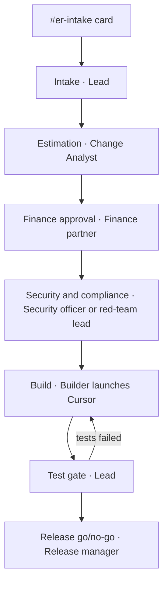
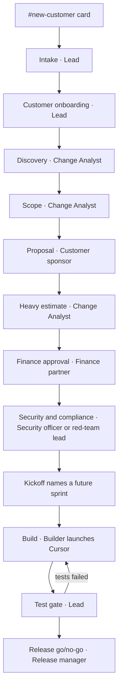

# Release Desk SDLC

Northwind Bank runs two processes. Both are owned by five Grok Bot teammates: Release Desk Lead, Change Analyst, Standards, Security, and Builder. Desk does not hand work between them. Bots message each other, post on a thread per request, and store PID state in memory.

Canonical specs:

- [PID-ER v1.0.0](./PID-ER.v1.md) — `grok-bots/processes/pid-er.v1.json`
- [PID-NC v1.0.0](./PID-NC.v1.md) — `grok-bots/processes/pid-nc.v1.json`

Human gates stay open until a person replies in the request thread. No bot sets a gate to approved. Security runs on every change. The iteration gate is still `red_team|security`: one human signature of either kind.

## PID-ER

Enhancement for a customer and product the bank already runs. Fixed two-week sprint. No onboarding, discovery, scope workshop, or customer proposal.

## PID-NC

New customer, or a product the bank does not yet run for them. Kickoff first. Extra stages happen before the shared finance stage, and the estimate is a phased cost range.

## Stage owners

The owner bot drives the stage. Consulting bots are asked with a `consult` message. The human approver is the only one who can close a human gate. Empty cells have no human approver.

| Stage | PID | Owner bot | Consulting bots | Human approver |
| --- | --- | --- | --- | --- |
| Intake | both | Lead | Change Analyst | |
| Customer onboarding | NC | Lead | Change Analyst | |
| Discovery | NC | Change Analyst | Standards, Security | |
| Scope | NC | Change Analyst | Standards | |
| Proposal | NC | Lead | Change Analyst, Standards | Customer sponsor |
| Estimation | ER | Change Analyst | Standards | |
| Estimation | NC | Change Analyst | Builder, Security, Standards | |
| Finance approval | both | Lead | Change Analyst | Finance partner |
| Security and compliance approval | both | Security | Standards, Change Analyst | Security officer or AI red-team lead |
| Build | both | Builder | Security, Standards | |
| Test gate | both | Lead | Builder, Security | |
| Release gate | both | Lead | Security, Standards, Builder | Release manager |

## How a request moves

1. Lead opens one thread in the intake channel and writes `pid.state.{requestId}`.
2. Lead sends a teammate message in the shape of `grok-bots/protocols/handoff.v1.json`.
3. The owner bot stores its slice and sends `stage-return`. Builder sends `build-result` with the pull request and the test result.
4. Lead appends a stage-transition record, posts it on the thread, and messages the next owner.
5. On a human gate, Lead posts a card and waits. The reply routine copies the person's decision. A bot reply does not count.

Channels: `#er-intake`, `#new-customer`, `#release-desk`. Gate cards are mirrored to `#release-desk`. The request thread stays in the intake channel.
