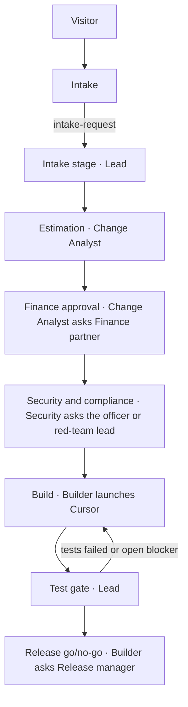
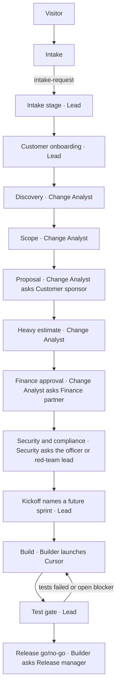

# Release Desk SDLC

Northwind Bank runs two processes, PID-ER and PID-NC, both at version 1.1.0. Seven Grok Bot teammates run them: Intake, Release Desk Lead, Change Analyst, Standards, Security, Builder, and Release Desk Log. Intake is the public front door and sends `intake-request` to Lead. Lead is the only writer of `pid.state` and sends `public-status` back. Desk does not move the work. Desk reads the Log.

Visitors start at `intake.vishalmathur.org` (`apps/intake`). Intake checks the card and hands it to Lead. It does not approve a gate. The request thread is Lead's chat.

Canonical specs:

- [PID-ER v1.1.0](./PID-ER.v1.md) — `grok-bots/processes/pid-er.v1.json`
- [PID-NC v1.1.0](./PID-NC.v1.md) — `grok-bots/processes/pid-nc.v1.json`
- [Handover diagram](./release-desk-handover-diagram.png) — rendered by `scripts/render_handover_diagram.py`

Security runs on every change. The iteration gate is still `red_team|security`: one human signature of either kind, raised by Security.

## PID-ER

Enhancement for a customer and product the bank already runs. Fixed two-week sprint. No onboarding, discovery, scope workshop, or customer proposal.

## PID-NC

New customer, or a product the bank does not yet run for them. Kickoff first. Extra stages happen before the shared finance stage, and the estimate is a phased cost range.

## Stage owners

The owner bot drives the stage and, on a human gate, asks Vishal in its own chat. Consulting bots are asked with a `consult` message. Lead is the only writer of `pid.state`. Empty human-approver cells have no human gate.

| Stage | PID | Owner bot | Consulting bots | Human approver |
| --- | --- | --- | --- | --- |
| Intake | both | Lead | Change Analyst | |
| Customer onboarding | NC | Lead | Change Analyst | |
| Discovery | NC | Change Analyst | Standards, Security | |
| Scope | NC | Change Analyst | Standards | |
| Proposal | NC | Change Analyst | Standards | Customer sponsor |
| Estimation | ER | Change Analyst | Standards | |
| Estimation | NC | Change Analyst | Builder, Security, Standards | |
| Finance approval | both | Change Analyst | | Finance partner |
| Security and compliance approval | both | Security | Standards, Change Analyst | Security officer or AI red-team lead |
| Build | both | Builder | Security, Standards | |
| Test gate | both | Lead | Builder, Security | |
| Release gate | both | Builder | Security, Standards | Release manager |

## Human gates

`gateRaisedBy` is `stage-owner`. Lead never asks Vishal for these decisions. The owner records the reply verbatim, with an ISO-8601 time, and returns it to Lead. Lead rejects any approval that does not come from that owner with a human `decidedBy`.

| Gate | Approver role | Raising bot |
| --- | --- | --- |
| proposal | Customer sponsor | Change Analyst |
| finance-approval | Finance partner | Change Analyst |
| security-compliance-approval | Security officer or AI red-team lead | Security |
| release-gate | Release manager | Builder |
| test-gate | none | Lead decides from the build result and Security's blockers. There is no human card. |

Vishal merges in GitHub himself after the release GO. No bot merges.

## Channels: chat only

The request thread is Lead's chat. `thread.channel` is `lead-chat` for both PIDs. Gate cards are asked in the owning bot's chat. Teammate messages are the bot-to-bot channel. There is no other channel.

## Audit log

Release Desk Log (`3824a7e2-512f-4a5b-a0bd-5202fd8dffbd`) is the append-only audit bot. Every teammate copies it, priority false, on each handoff.v1 message sent or received, each REJECT, and each gate ask or decision. Lead also copies each stage transition. The Log never routes and never approves.

It writes `{requestId}.jsonl` under the directory named by `RELEASEDESK_LOG_DIR` (on the shared box, `/workspace/releasedesk-log`). Desk `/handoff` reads that directory, or a `.jsonl` file chosen in the browser, and shows the trace. Real logs are not committed.

## How a request moves

1. Lead opens one thread in Lead's chat and writes `pid.state.{requestId}`.
2. Lead sends a teammate message in the shape of `grok-bots/protocols/handoff.v1.json`.
3. The owner bot stores its slice and sends `stage-return`. Builder sends `build-result` with the pull request and the test result.
4. On a human gate, Lead sets `ready-for-human` and hands the stage to the owner. The owner asks Vishal and returns the decision.
5. Lead appends a stage-transition record, copies the decision into `pid.decisions`, and messages the next owner.
