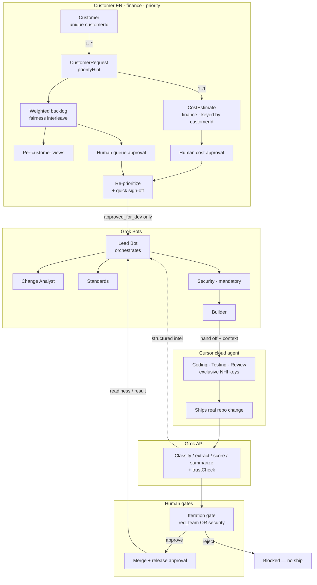

# SpaceXAI demo — two slides (+ optional third)

Speaker notes for a ≤3-minute open, then live system.  
Canonical store copy also lives at the Project docs store.

**Live control plane (enterprise path):** `npm run desk` → http://localhost:3001/control · `npm run demo:control-plane`

---

## Slide 1 — Problem statement and assumptions

**Title:** SDLC optimization for multi-customer IT services

**Problem statement:** An IT services organization delivering applications to many clients needs faster, safer release cycles across the portfolio. Late security and policy findings burn delivery windows, and decision-makers lack a single trusted view of what is safe to ship versus still blocked.

**Who feels it:** Delivery and release owners responsible for multiple client applications.

**What it costs today:** Slipped windows, repeated specialist chase-down, and no consolidated readiness signal before merge and release.

**Who buys the fix:** Engineering and risk leaders who want speed without giving up human authority on critical decisions.

**Assumptions**
1. Space 1 focus — software delivery and release readiness across a multi-customer portfolio.
2. Bots advise and orchestrate; humans keep merge and release authority.
3. Required stack: Grok Bot (Lead + specialists) → Cursor cloud agent ships real repo changes → shipped code calls Grok API for workflow intel.
4. MOCK only when credentials are absent; the live path is designed and rehearsed for the room.

**Business requirements (IT services org)**
1. **Agility** — shorter, safer release cycles across many client apps.
2. **Security** — catch policy and security blockers early enough that they do not blow the delivery window.
3. **Token optimization = cost / margin** — in an ITS organization every token is a line item on a client invoice; lean orchestration protects margin while still producing auditable readiness.

**Spoken (≤45s):**  
“IT services org, many client apps — we need faster, safer releases across the portfolio. Late findings burn windows, and nobody has one answer for safe to ship. Three drivers: agility, security, and token optimization as cost and margin control — every token hits a client invoice. Humans keep merge authority. Slide two is the map — then we go live.”

---

## Slide 2 — Architecture / workflow

**Title:** Customer intake → Lead → Grok Bot → Cursor → Grok API → back to Lead

**One-liner:** Multi-customer ER + finance + priority feed Lead; bots and Cursor ship Grok intel; humans gate iteration/merge/release; readiness closes the circle back to Lead.

**On-slide callouts**
1. **Intake ER** — Customer → Request → CostEstimate (`customerId`); dual cost + queue approvals; fairness priority before Lead
2. **Grok Bot lane** — Lead · Change Analyst · Standards · Security · Builder
3. **Cursor → Grok API** — Coding ships; Testing∥Review never merge; classify/extract/score/summarize + trustCheck
4. **Full circle** — merge/release result and intel feed **back to Lead**; never auto-merge

**Live map:** `/control` · `/mvp` · `/agents` · `/desk` → intake + run gates + `grok-release-intel.ts`

**Spoken (≤60s):**  
“Customers enter with requests, cost estimates, and priority. Finance and queue humans both approve — then fairness-ordered work hits Lead. Lead sequences specialists; Builder hands to Cursor; shipped code calls Grok API. Iteration and merge stay human. Readiness closes the circle back to Lead. Now we open the live system.”

---

## Optional Slide 3 — Trade-offs / what’s next

**Chose not to build (yet):** Full production bot-import UI; always-on pollers; auto-approve of production merges; deep audit-tour as the primary demo beat.

**With more time:** Live Lead wiring on every iteration; real Cursor agent runs without MOCK; stronger trust harness for Grok API outputs; enterprise SSO and secrets rollout.

**Skip unless they ask “what’s next.”**

---

## After the slides (live)

Use [spacexai-room-runbook.md](./spacexai-room-runbook.md) for commands + clicks + MOCK vs live matrix.
