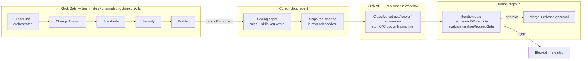

# SpaceXAI demo — two slides (+ optional third)

Use as speaker notes / paste into any deck. **≤3 minutes total**, then live system.  
Brief: two slides mandatory; most time live; expect live bot edits.

---

## Slide 1 — Problem statement and assumptions

**Title:** SDLC optimization for multi-customer IT services — the problem

**Problem statement:** An IT services organization delivering applications to many clients needs faster, safer release cycles across the portfolio. Late security and policy findings burn delivery windows; decision-makers can’t tell what’s safe to ship. Shown here with Northwind KYC as the worked example / proof.

**Who feels it:** Delivery / release owners across a multi-customer portfolio (illustrated with Northwind KYC).

**What it costs today:** Late security/policy findings blow delivery windows; no single view of “safe to ship” vs still blocked across client apps.

**Who buys the fix:** Engineering + risk leaders who keep human merge authority (auditable approvals on merge/release).

**One-liner:** Optimize the SDLC for an IT services org serving many customers — asynchronous multi-bot release readiness, not one mega-prompt — with clear handoffs, real coding work via Cursor, and humans on critical approvals. Shown here with Northwind KYC.

**Assumptions**
1. Space 1 — software delivery & release readiness (portfolio SDLC; Northwind KYC as the worked example).
2. Bots advise and orchestrate; **humans** keep merge/release authority (and red team / security iteration sign-off).
3. Required stack: **Grok Bot** (Lead + specialists) → **Cursor cloud agent** ships repo code → that code **calls Grok API** for real workflow intel (classify / extract / score / summarize).
4. MOCK only where keys are absent; live path is designed and rehearsed for the room.

**Business requirements:** agility, security, token optimization.

**Spoken (≤45s):**  
“IT services org, many client apps — need faster safer releases across the portfolio. Late security and policy findings burn windows; nobody can tell what’s safe to ship. Drivers are agility, security, and token optimization. Shown here with Northwind KYC. Buyers are eng and risk leaders who keep human merge authority. Slide two is the map — then we live in the bots.”

---

## Slide 2 — Architecture / workflow

**Title:** Release Desk — Grok Bot → Cursor → Grok API

**One-liner:** Lead + specialists hand off asynchronously; Builder launches Cursor; shipped code calls Grok API; iteration gate needs red team **or** security before human merge/release.

**On-slide callouts only (4)**
1. **Grok Bot lane** — Lead · CA · Standards · Security · Builder (clear jobs/boundaries)
2. **Cursor** — Builder hands off; agent ships real repo code under your rules/skills
3. **Grok API** — called by what the agent shipped; bots act on structured result
4. **Human** — iteration gate (`red_team` \| `security`) then merge/release

**Spoken (≤60s):**  
“Lead sequences specialists. Builder hands to Cursor with context and our rules. The agent ships code that calls Grok API for intel the workflow consumes. Humans still own the iteration gate and final merge. Now we open the live system.”

---

## Optional Slide 3 — Trade-offs / what’s next

**Chose not to build (yet):** Full x.ai/bot production import UI; always-on poller; auto-approve of production code; logging-deep audit tour in the demo.

**With more time:** Live Lead wiring every iteration (PR #15 path); real Cursor agent run without MOCK; golden-sample trust harness for Grok API outputs; enterprise SSO/secrets rollout.

**Skip Wednesday unless they ask “what’s next.”**

---

## After the slides (live — most of the 45 min)

1. Trigger workflow end to end in Desk / Grok Bot channel  
2. Open each bot: persona, skills, routines, connectors  
3. Open repo: rules/skills, cloud agent run, where Grok API is called  
4. Walk every handoff + every human approve (iteration gate money shot)  
5. Leave buffer for **live bot change** + Q&A
