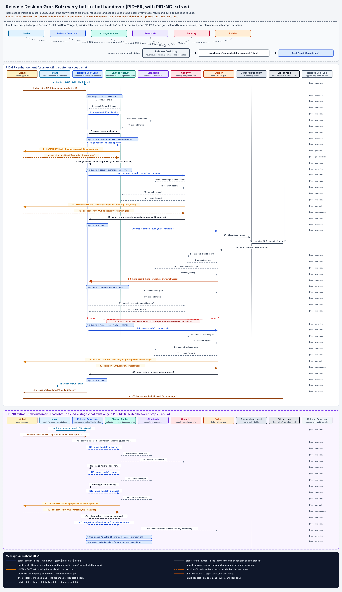
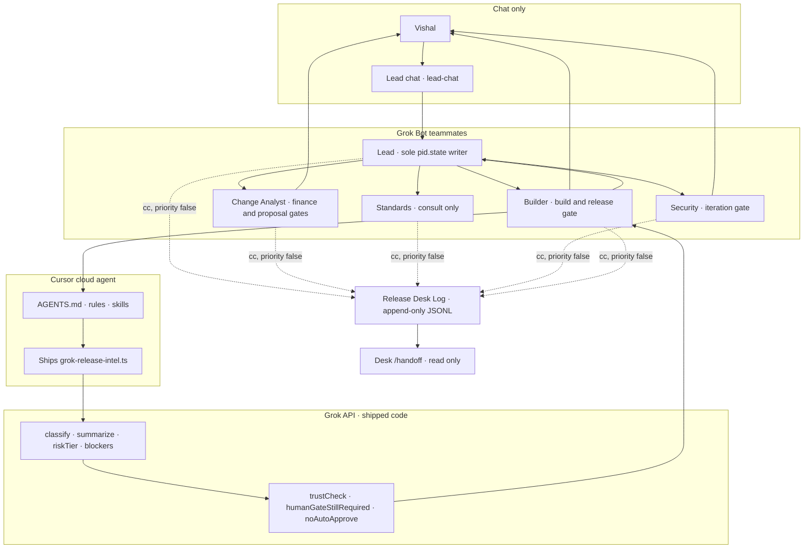

# Slide 2 — Architecture / workflow

**Title:** Release Desk — six Grok Bot teammates, chat only

**One-liner:** Lead, Change Analyst, Standards, Security, and Builder hand work with handoff.v1. Release Desk Log records every copy. Builder launches Cursor. Shipped Desk code calls the Grok API. The iteration gate still needs red team or security before Vishal merges.

## Diagram

The handover sequence is the picture, not a second Mermaid.

Source: `docs/sdlc/release-desk-handover-diagram.svg`, rendered by `scripts/render_handover_diagram.py`.

## Bot-native shape

## Callouts

1. **Six teammates.** Five move the work. Release Desk Log only records it and never routes or approves.
2. **Gate owner asks.** Change Analyst raises proposal and finance. Security raises security-compliance, which is the `red_team|security` iteration gate. Builder raises release. Lead does not ask Vishal for a gate.
3. **Chat only.** The request thread is Lead's chat (`lead-chat`). There is no other channel.
4. **Why Cursor.** Builder launches a cloud agent under AGENTS.md, the Grok rule, and `ship-grok-release-intel`. The agent opens a pull request and does not merge.
5. **Why this Grok API.** `grok-release-intel.ts` returns classify, summarize, `riskTier`, and `blockers`. Builder copies that into `build-result.testsSummary`. Security and Lead use `riskTier` and blockers at the test gate. `trustCheck.humanGateStillRequired` and `noAutoApprove` stay true.
6. **Proof gate.** `evaluateIterationProceedGate` still needs a human `red_team` or `security` signature. ATLAS/OWASP still blocks a review-ready merge.

## Source files

- Diagram: [sdlc/release-desk-handover-diagram.png](./sdlc/release-desk-handover-diagram.png)
- Processes: `grok-bots/processes/pid-er.v1.json`, `pid-nc.v1.json` (version 1.1.0)
- Brief slide wording: [spacexai-two-slides.md](./spacexai-two-slides.md)
