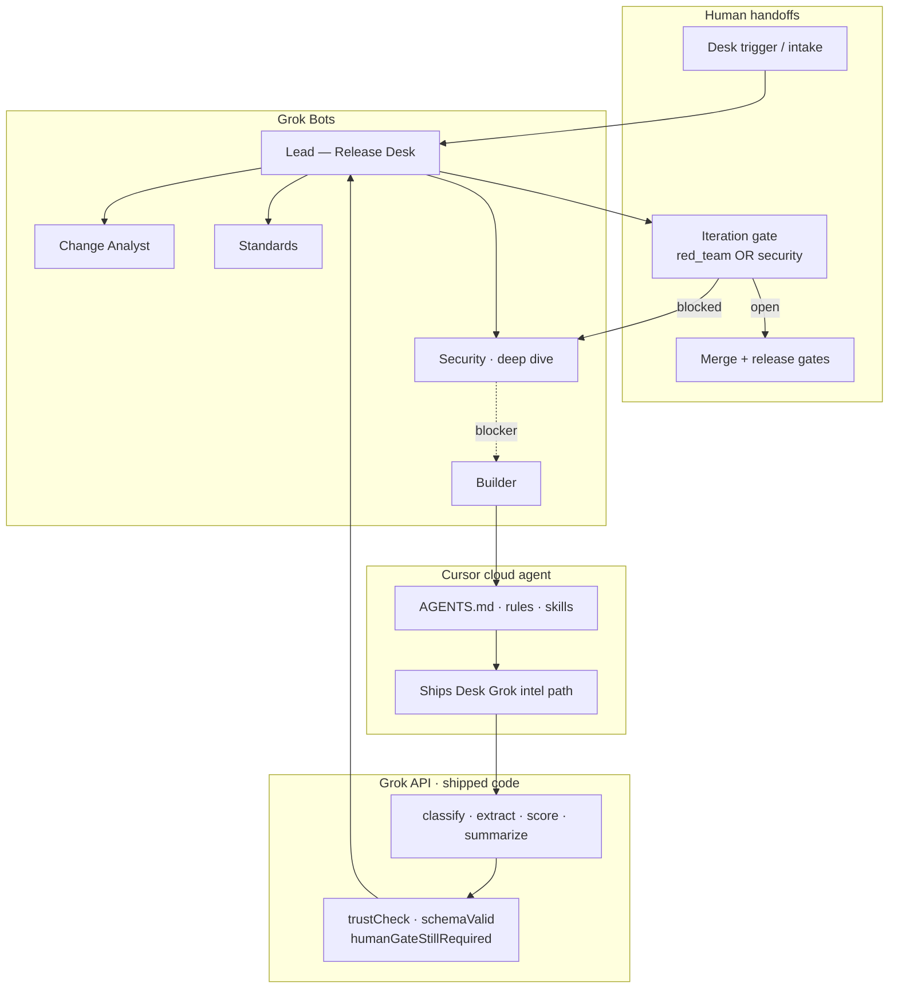

# Slide 2 — Architecture / workflow

**Title:** Release Desk — Grok Bot → Cursor → Grok API

**One-liner:** Lead + specialists hand off asynchronously; Builder launches Cursor; shipped Desk code calls Grok API; iteration gate needs red team **or** security before humans merge/release.

## Diagram (paste into Mermaid)

## Callouts (say while tracing)

1. **Why each bot** — Lead owns run; CA = diff/impact; Standards = policy evidence; Security = release blockers; Builder = only bot that launches Cursor.
2. **Why Cursor** — real repo change under our rules/skills, not chat theater.
3. **Why this Grok API** — structured classify/extract/score/summarize on release findings; `trustCheck` keeps humans in the loop.
4. **Proof gate** — `evaluateIterationProceedGate` (PR #14 spine).

## Source files

- Mermaid above (challenge-shaped)
- Gate detail: [demo-architecture-diagram.md](./demo-architecture-diagram.md) (PR #14 collapsed gate)
- Brief slide wording: [spacexai-two-slides.md](./spacexai-two-slides.md)
