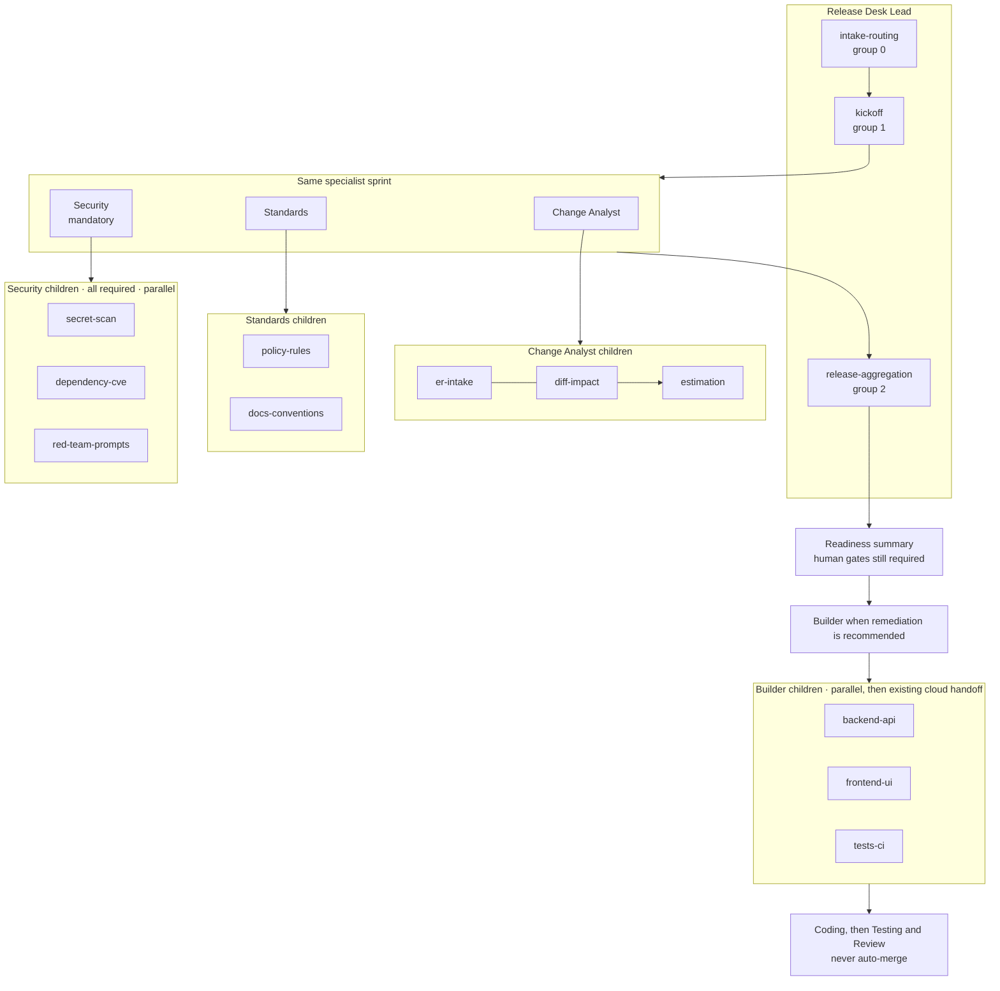

# Parent bots and child sub-agents

The five Release Desk bots stay the roster: **Release Desk Lead**, **Change Analyst**, **Standards**, **Security**, and **Builder**. Their Grok Bot app ids in `grok-bots/registry.json` are unchanged. Child sub-agents are slices of a parent. They are not registry rows, not `catalog.bots` entries, and not new `AgentRole` values.

Each parent delegates to its children, runs a parallel group together, then aggregates a `SubAgentAggregate`. The public specialist result fields (findings, deviations, handoffs, readiness) stay on the parent.

## Parent to child map

| Parent | Child | Parallel group | Responsibility |
| --- | --- | --- | --- |
| Release Desk Lead | `lead.intake-routing` | 0 | Route the run onto the ER sprint track or the new-customer kickoff track. |
| Release Desk Lead | `lead.kickoff` | 1 | Discover scope and write a proposal that still needs human approval. |
| Release Desk Lead | `lead.release-aggregation` | 2 | Aggregate specialist results into readiness without approving gates. |
| Change Analyst | `change_analyst.er-intake` | 0 | Normalize the ER or change request into repository, refs, and focus paths. |
| Change Analyst | `change_analyst.diff-impact` | 0 | Read the git range and score path-level impact. |
| Change Analyst | `change_analyst.estimation` | 1 | Estimate effort from the diff and impact findings. |
| Standards | `standards.policy-rules` | 0 | Evaluate the change against Northwind policy rules. |
| Standards | `standards.docs-conventions` | 0 | Check docs and repo conventions that sit beside the policy rules. |
| Security | `security.secret-scan` | 0 | Scan change input for private keys and hardcoded credentials. |
| Security | `security.dependency-cve` | 0 | Correlate dependencies to advisory and CVE fixtures. |
| Security | `security.red-team-prompts` | 0 | Review AI surfaces and prompt text for red-team bypasses. |
| Builder | `builder.backend-api` | 0 | Plan the backend and API slice of the remediation. |
| Builder | `builder.frontend-ui` | 0 | Plan the frontend and UI slice of the remediation. |
| Builder | `builder.tests-ci` | 0 | Plan the tests and CI slice of the remediation. |

Security children are all required. Builder still hands off to the existing Cursor **Coding**, **Testing**, and **Review** cloud agents after the layer plan. Those cloud agents are not these children.

## Two tracks, one sprint

`lead.intake-routing` reads `metadata.track`.

- `er_sprint` (default): the item is already scoped. `lead.kickoff` records `applied: false` and does not open a proposal.
- `new_customer_kickoff` (or `kickoff`): `lead.kickoff` writes discovery, scope, and a proposal with `humanApprovalRequired: true` and `approved: false`. The same specialist sprint still runs, with the proposal attached to the specialist input.

Neither track approves merge, release, or the iteration gate.

## Delegation flow

Groups with the same number run with `Promise.all`. The next group starts after that group settles, and it can read the earlier payloads. A child that throws becomes `failed`. A child that exceeds its budget becomes `timed_out`. The late promise is not awaited.

## Result schema and rollup

`SubAgentChildResult` records `id`, `parentId`, `responsibility`, `status` (`completed`, `failed`, `timed_out`, `skipped`), `summary`, `payload`, `durationMs`, `required`, and `parallelGroup`.

`SubAgentAggregate` records the children plus `completedIds`, `failedIds`, `timedOutIds`, `skippedIds`, `status`, and `securityGateHeld`.

| Situation | Aggregate status | Security |
| --- | --- | --- |
| Every required child completed | `completed` | `securityGateHeld` false |
| Only an optional child failed or timed out | `partial` | false unless the parent is Security |
| A required child failed or timed out | `failed` | Security sets `securityGateHeld` true |
| A required Security child is `skipped` | `failed` | `securityGateHeld` true |
| Any Security child failed or timed out | `failed` | `securityGateHeld` true |

`securityGateHeld` means the Security parent must not report a clean pass. The runner adds a release-blocking finding `security-sub-agent-fail-closed` and returns `securityCheckFailed: true`. A timed-out dependency slice is not treated as "no advisories".

That flag is not an approval. `evaluateIterationProceedGate` is unchanged: the iteration can proceed only after a human `red_team` or `security` sign-off. Secret-scan output never includes the matched secret value. Live Cursor dispatch still requires `RELEASEDESK_CLOUD_CLIENT=real` outside CI; these tests stay on mocks.
